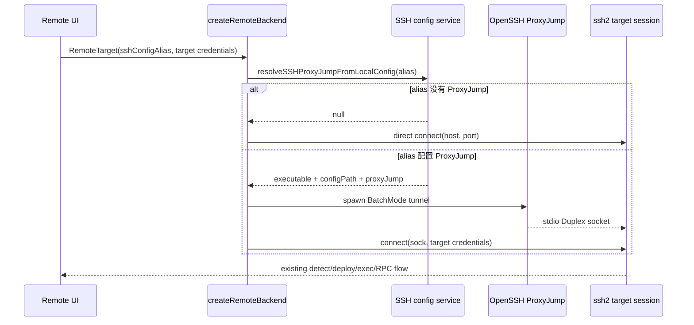

# SSH ProxyJump 远程连接规格

## 目标与范围

当用户从本机 SSH config 选择了带 `ProxyJump` 的 Host alias 时，ZCode 应沿用该跳板链路连接目标机，同时复用现有 `ssh2` 的目标机认证、SFTP、exec、部署与 RPC 链路。

首版支持标准 OpenSSH `ProxyJump` 的单跳和多跳语法。跳板机认证由本机 OpenSSH、SSH Agent 和 SSH config 负责，并强制使用非交互模式。首版不支持任意 `ProxyCommand`，也不支持跳板机密码或 OTP 交互。

## 所有权与依赖方向

- `packages/services/src/system/sshConfigAlias.ts` 是本机 SSH config 解析的唯一所有者。它通过 `ssh -G` 返回有效的 `ProxyJump`、OpenSSH 可执行文件和根配置路径。
- `packages/server/src/remote/create-backend.ts` 在创建 SSH backend 时按 `sshConfigAlias` 请求解析结果，不持久化跳板地址或凭据。
- `packages/server/src/remote/sshProxyJump.ts` 拥有 OpenSSH 子进程、stdio 双工适配及退出错误归一化。
- `packages/server/src/remote/ssh-backend.ts` 拥有最终 `ssh2` 会话，并在连接结束或取消时释放跳板进程。
- UI、共享协议和远程目标持久化结构保持不变；`sshConfigAlias` 仍是唯一跨层标识。

依赖方向固定为 `server -> @zcode/services/node`，不得由 services 反向依赖 server。

## 连接时序



事件顺序必须是：解析 alias -> 创建跳板隧道 -> `ssh2` 目标机握手 -> 现有远程部署流程。清理按相反顺序执行，并且重复清理必须幂等。

## OpenSSH 隧道契约

对于 `ProxyJump jump1,jump2`，ZCode 启动等价于以下参数数组的子进程（不经过 shell）：

```text
ssh -T -F <config> -o BatchMode=yes -o ExitOnForwardFailure=yes -o ClearAllForwardings=yes -J jump1 -W <targetHost>:<targetPort> -- jump2
```

单跳时省略 `-J`，直接把唯一 jump host 作为 OpenSSH 目标。目标机的 SSH 握手仍由 `ssh2` 完成，因此不会把目标机密码交给 OpenSSH。

安全不变量：

- 子进程必须使用参数数组启动，禁止 shell 拼接。
- `ProxyJump` 每一跳必须是单个有效 endpoint，拒绝空项、控制字符、空白字符及以 `-` 开头的值。
- 跳板认证强制 `BatchMode=yes`，并禁用 askpass，避免后台连接挂起等待输入。
- 日志只记录跳数、退出码和受限长度的 stderr，不记录目标机密码、私钥或完整内部地址链。

## 失败与恢复

- 未配置 `ProxyJump`：保持原有直连行为。
- SSH config 不存在、alias 为空或 `ssh -G` 查询失败：返回明确错误；不得猜测跳板配置。
- 配置了 `ProxyJump` 但本机找不到 OpenSSH：返回明确错误；不得静默直连。
- `ProxyJump` 值非法：在启动任何进程前拒绝连接。
- 跳板进程在握手前退出：目标机连接失败，并附带截断后的 OpenSSH 错误摘要。
- 跳板进程在已连接后退出：通过现有 backend 断连事件上报一次。
- 用户取消、backend dispose 或 `ssh2` 关闭：立即关闭 socket 并终止跳板进程；重复调用无副作用。

## 验收场景

1. 未选择 SSH alias 或 alias 无 `ProxyJump` 时，连接配置与现有直连完全一致。
2. `ProxyJump jumper` 生成单跳 `-W` 隧道，不包含 `-J`。
3. `ProxyJump jump1,jump2` 用 `-J jump1` 连接最后一跳 `jump2`。
4. `ProxyJump none` 按直连处理。
5. 恶意或非法 endpoint 在 spawn 前被拒绝。
6. OpenSSH 异常退出、backend 取消和正常关闭都只清理一次，不遗留子进程。
7. 现有目标机密码、私钥、SFTP fallback 和远程部署行为不变。
